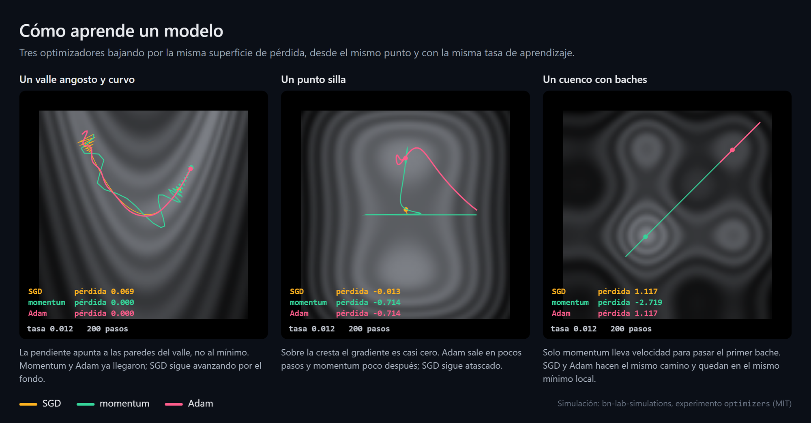
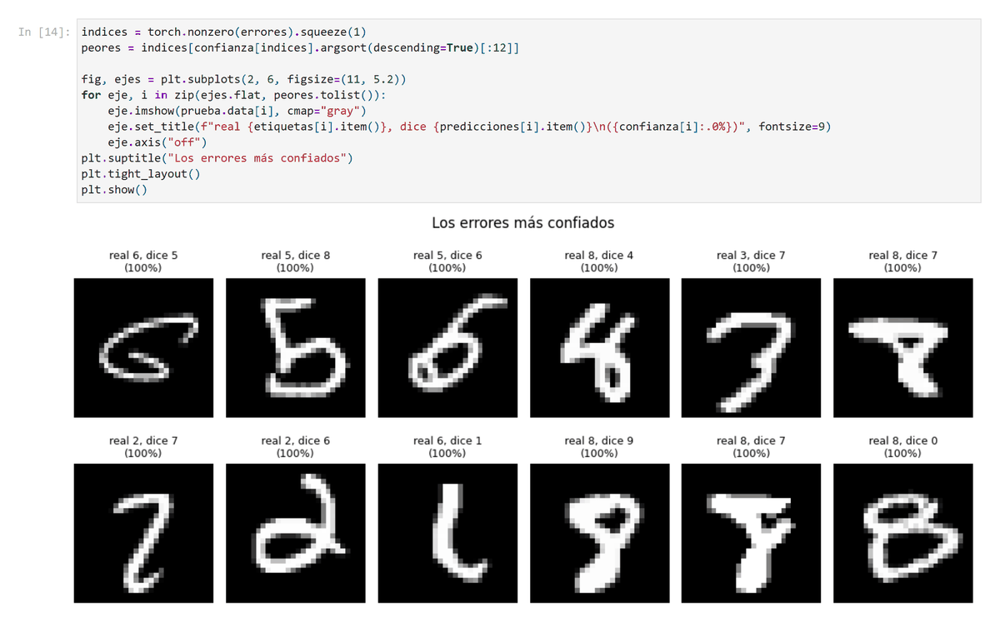
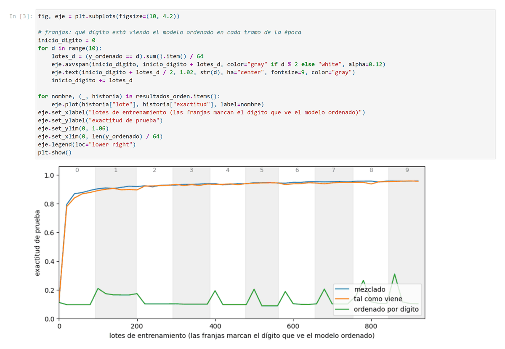
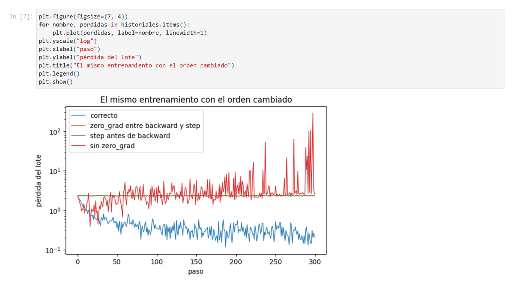
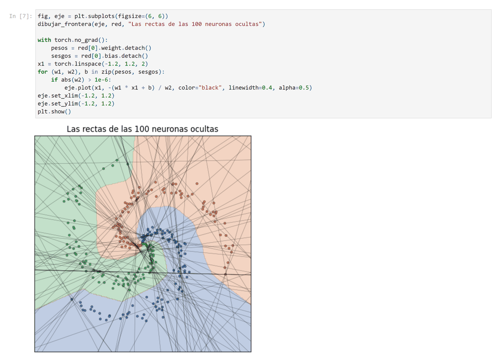

# PyTorch desde cero

Curso de PyTorch en español, en notebooks. Cada notebook explica un tema paso a paso, con el código ejecutado y los gráficos a la vista, y termina con un resumen y ejercicios.

La idea es entender qué hace cada línea y por qué: primero se usa una herramienta, después se abre para ver cómo funciona, y al final se justifica con su matemática.



SGD, momentum y Adam bajando por tres superficies de pérdida desde el mismo punto, con la misma tasa de aprendizaje. Es el tema de [Optimizadores](modulo-1/04-matematica-de-pytorch/04_optimizadores.ipynb) en el módulo 1 y de [Gradientes y optimizadores](modulo-2/02-entrenamiento/02_gradientes_y_optimizadores.ipynb) en el módulo 2. Imagen hecha con [bn-lab-simulations](https://github.com/4mser/bn-lab-simulations).

## Así se ven los notebooks

Cada notebook alterna explicación, código y resultados, y se puede leer en GitHub sin ejecutar nada. Algunas celdas:

<table>
  <tr>
    <td width="50%" valign="top">
      <a href="modulo-2/04-clasificacion-de-imagenes/01_mnist_de_punta_a_punta.ipynb"></a>
      <br><b>MNIST de punta a punta</b>: los errores en que el modelo estaba más seguro, todos con una confianza de prácticamente 100%.
    </td>
    <td width="50%" valign="top">
      <a href="modulo-2/04-clasificacion-de-imagenes/02_experimentos_con_mnist.ipynb"></a>
      <br><b>Experimentos con MNIST</b>: con los datos ordenados por dígito, el modelo olvida cada dígito al pasar al siguiente.
    </td>
  </tr>
  <tr>
    <td width="50%" valign="top">
      <a href="modulo-2/02-entrenamiento/02_gradientes_y_optimizadores.ipynb"></a>
      <br><b>Gradientes y optimizadores</b>: el mismo entrenamiento con el orden de <code>zero_grad</code>, <code>backward</code> y <code>step</code> cambiado. Solo el orden correcto aprende.
    </td>
    <td width="50%" valign="top">
      <a href="modulo-1/05-profundizacion/03_espiral_y_fronteras_de_decision.ipynb"></a>
      <br><b>La espiral</b>: la frontera de decisión de una red y las rectas de sus 100 neuronas ocultas, de las que está hecha.
    </td>
  </tr>
  <tr>
    <td width="50%" valign="top">
      <a href="modulo-3/05-profundizacion/01_fuga_de_datos.ipynb"></a>
      <br><b>Fuga de datos</b>: fotos de prueba y sus parecidas en entrenamiento. Si se mezclan, la exactitud sale demasiado buena.
    </td>
    <td width="50%" valign="top">
      <a href="modulo-4/00-convoluciones/01_filtros_y_mapas_de_caracteristicas.ipynb"></a>
      <br><b>Filtros y mapas de características</b>: lo que deja cada filtro de una capa convolucional sobre una foto de girasol.
    </td>
  </tr>
</table>

## Contenido

Los notebooks siguen los módulos del curso de PyTorch de DeepLearning.AI en Coursera. Cada módulo es una carpeta, dividida en partes.

### [Módulo 1: de los tensores a una red neuronal](modulo-1)

| Parte | Notebook | Qué cubre |
|---|---|---|
| **00 · Fundamentos** | [Tensores, autograd y una neurona](modulo-1/00-fundamentos/01_tensores_autograd_y_una_neurona.ipynb) | Tensores, formas, broadcasting, producto matricial, autograd, una neurona entrenada de tres formas |
| | [Tensores a fondo](modulo-1/00-fundamentos/02_tensores_a_fondo.ipynb) | Crear tensores desde listas y NumPy, memoria y strides, vistas y copias, indexado, promoción de tipos, broadcasting, máscaras, los errores más comunes y cómo leerlos |
| **01 · Red neuronal simple** | [Una red neuronal simple](modulo-1/01-red-neuronal-simple/01_red_neuronal_simple.ipynb) | El flujo completo: datos, modelo, pérdida, optimizador, entrenamiento y predicción. De una neurona a una red con capa oculta y ReLU |
| **02 · Descenso de gradiente** | [Descenso de gradiente](modulo-1/02-descenso-de-gradiente/01_descenso_de_gradiente.ipynb) | Qué hace `optimizer.step()`, tasa de aprendizaje, superficie de pérdida, por qué normalizar |
| | [SGD y mini-batches](modulo-1/02-descenso-de-gradiente/02_sgd_y_minibatches.ipynb) | Gradiente estocástico, tamaño de lote, ruido, tasa decreciente, `DataLoader` |
| **03 · Optimalidad** | [Mínimos, convexidad y puntos silla](modulo-1/03-optimalidad/01_optimalidad.ipynb) | Condiciones de optimalidad, hessiano, convexidad, ecuaciones normales, número de condición, por qué la pérdida de una red no es convexa |
| **04 · Matemática de PyTorch** | [Autograd y regla de la cadena](modulo-1/04-matematica-de-pytorch/01_autograd_y_regla_de_la_cadena.ipynb) | Jacobianos, productos vector-jacobiano, retropropagación a mano |
| | [Capas y activaciones](modulo-1/04-matematica-de-pytorch/02_capas_y_activaciones.ipynb) | `nn.Linear`, inicialización, `ReLU`, `Sigmoid`, `Tanh`, `Softmax`, estabilidad numérica |
| | [Funciones de pérdida](modulo-1/04-matematica-de-pytorch/03_funciones_de_perdida.ipynb) | Máxima verosimilitud, `MSELoss`, `L1Loss`, `HuberLoss`, `BCELoss`, `BCEWithLogitsLoss`, `CrossEntropyLoss` |
| | [Optimizadores](modulo-1/04-matematica-de-pytorch/04_optimizadores.ipynb) | `SGD`, `weight_decay`, momento, Nesterov, `RMSprop`, `Adam`, `AdamW` |
| **05 · Profundización** | [El perceptrón de Rosenblatt](modulo-1/05-profundizacion/01_perceptron.ipynb) | La regla de aprendizaje, el teorema de convergencia de Novikoff, por qué XOR no se puede con una neurona, y la regla vista como descenso de gradiente |
| | [XOR y redes feedforward](modulo-1/05-profundizacion/02_xor_y_redes_feedforward.ipynb) | La solución exacta de XOR de Goodfellow, cómo la capa oculta transforma el espacio, por qué algunas redes se atascan, aproximación universal y el costo de no tener profundidad |
| | [La espiral: fronteras de decisión](modulo-1/05-profundizacion/03_espiral_y_fronteras_de_decision.ipynb) | Clasificador lineal contra una red en la espiral de CS231n, de qué rectas está hecha la frontera, el tamaño de la capa oculta y la regularización L2 |
| | [Ajuste polinomial y sobreajuste](modulo-1/05-profundizacion/04_ajuste_polinomial_y_sobreajuste.ipynb) | La sección 1.1 de Bishop: error de entrenamiento y de prueba, coeficientes que explotan, más datos, regularización L2, validación cruzada y la misma solución con LBFGS |
| | [Buscador de tasa y one-cycle](modulo-1/05-profundizacion/05_buscador_de_tasa_y_one_cycle.ipynb) | El buscador de tasa de aprendizaje y la política one-cycle de fast.ai, implementados a mano y comparados con OneCycleLR, contra una tasa fija |
| | [Un proyecto de punta a punta](modulo-1/05-profundizacion/06_proyecto_de_punta_a_punta.ipynb) | Del archivo CSV al modelo guardado: validar datos, separar entrenamiento, validación y prueba, líneas base, Dataset, DataLoader y nn.Module, punto de control, análisis de errores y el sesgo entre entrenamiento y servicio |

En la parte 04 cada función de PyTorch se trata igual: su fórmula, de dónde sale, una implementación a mano y una comprobación con `torch.allclose` de que coincide con la de PyTorch.

La parte 05 lleva a código las lecturas recomendadas del módulo: cada notebook toma una lectura y reproduce sus ideas centrales.

Lecturas y videos recomendados para este módulo: [Recursos para profundizar](modulo-1/README.md#recursos-para-profundizar).

### [Módulo 2: el flujo de trabajo de PyTorch](modulo-2)

| Parte | Notebook | Qué cubre |
|---|---|---|
| **00 · Datos** | [Transforms, Dataset y DataLoader](modulo-2/00-datos/01_transforms_dataset_y_dataloader.ipynb) | MNIST con `torchvision`, `ToTensor`, `Normalize` y de dónde salen 0.1307 y 0.3081, `Compose`, transformaciones aleatorias, un `Dataset` que carga a pedido, lotes y mezcla con `DataLoader`, y cuánto cuesta transformar en cada época |
| **01 · Modelos** | [De `Sequential` a `nn.Module`](modulo-2/01-modelos/01_nn_module.ipynb) | `__init__` y `forward`, qué registra `super().__init__()`, capas en listas que no se entrenan, `model(x)` contra `model.forward(x)`, `Flatten` y cómo leer un error de formas, contar parámetros, conexiones residuales, `eval()` y `no_grad()` |
| **02 · Entrenamiento** | [MSE y entropía cruzada en la práctica](modulo-2/02-entrenamiento/01_funciones_de_perdida_en_la_practica.ipynb) | Por qué elevar al cuadrado, logits y `softmax`, el costo de equivocarse con confianza, qué espera `CrossEntropyLoss`, el doble `softmax`, MSE para clasificar y por qué las pérdidas no se comparan entre sí |
| | [Gradientes y optimizadores](modulo-2/02-entrenamiento/02_gradientes_y_optimizadores.ipynb) | `backward()` no actualiza, qué dice el signo de un gradiente, por qué `zero_grad()`, cuatro órdenes equivocados y qué hace cada uno, acumulación de gradientes, tasas de aprendizaje de `SGD` contra `Adam` y por qué `Adam` no usa la tasa de `SGD` |
| **03 · Dispositivos** | [CPU, GPU y dónde vive cada tensor](modulo-2/03-dispositivos/01_cpu_gpu_y_dispositivos.ipynb) | `cuda`, `mps` y `cpu`, el error de dispositivos (reproducido sin GPU), `.to()` en tensores y en modelos, el patrón estándar, volver a NumPy, de qué depende la memoria de un entrenamiento y cuándo conviene la GPU |
| **04 · Clasificación de imágenes** | [MNIST de punta a punta](modulo-2/04-clasificacion-de-imagenes/01_mnist_de_punta_a_punta.ipynb) | El entrenamiento completo con validación, diez épocas, la prueba una sola vez, exactitud por dígito, matriz de confusión, los errores más confiados y un mensaje secreto escrito con dígitos |
| | [Experimentos con MNIST](modulo-2/04-clasificacion-de-imagenes/02_experimentos_con_mnist.ipynb) | Qué pasa sin mezclar y con los datos ordenados por dígito, lotes de 16, 64 y 512 medidos en épocas y en segundos, y por qué una red densa aprende igual con los píxeles desordenados |

El módulo 2 usa MNIST, que los notebooks descargan la primera vez en `modulo-2/data`.

### [Módulo 3: datos que un modelo puede usar](modulo-3)

Un jardín botánico quiere reconocer flores en fotos. Aquí se arma el camino de los datos hasta el modelo, con el dataset Oxford Flowers 102 (8.189 fotos), y se revisan los errores que más cuestan: transforms mal puestos, datos que se cuelan entre conjuntos y archivos rotos.

| Parte | Notebook | Qué cubre |
|---|---|---|
| **00 · Acceso** | [Un `Dataset` propio para Oxford Flowers](modulo-3/00-acceso/01_un_dataset_propio.ipynb) | Encontrar los archivos, asociar cada foto con su etiqueta y probar el `Dataset` antes de entrenar |
| **01 · Calidad** | [Transforms para fotos de todos los tamaños](modulo-3/01-calidad/01_transforms_para_fotos.ipynb) | Fotos de tamaños distintos, `Resize` y `CenterCrop`, `ToTensor`, `Normalize`, PIL contra tensores y un pipeline completo |
| **02 · Carga** | [Dividir los datos y armar los `DataLoader`](modulo-3/02-carga/01_division_y_dataloader.ipynb) | `random_split` 70/15/15, la trampa del transform compartido, la división oficial de Oxford, lotes y épocas |
| **03 · Robustez** | [Pipelines a prueba de fallas](modulo-3/03-robustez/01_pipelines_a_prueba_de_fallas.ipynb) | Aumento de datos al vuelo, archivos rotos, `verify()` contra `load()` y monitoreo de la carga |
| **05 · Profundización** | [Fuga de datos](modulo-3/05-profundizacion/01_fuga_de_datos.ipynb) · [Datos antes que el modelo](modulo-3/05-profundizacion/02_datos_antes_que_el_modelo.ipynb) · [Flowers 102 por dentro](modulo-3/05-profundizacion/03_flowers_102_el_articulo_original.ipynb) | Cómo se cuela la prueba en el entrenamiento, mejorar los datos con el modelo fijo, y el artículo original del dataset |

### [Módulo 4: redes convolucionales y cómo mantenerlas](modulo-4)

Usa el pipeline del módulo 3 para construir la convolución, armar una CNN y entender sus tamaños y campos receptivos. Después se ve cómo escribirla de forma que se pueda cambiar y depurar.

| Parte | Notebook | Qué cubre |
|---|---|---|
| **00 · Convoluciones** | [Filtros y mapas de características](modulo-4/00-convoluciones/01_filtros_y_mapas_de_caracteristicas.ipynb) | La convolución a mano y con `F.conv2d`, `nn.Conv2d` por dentro, relleno, paso y parámetros compartidos |
| **01 · Arquitectura** | [La arquitectura de una CNN](modulo-4/01-arquitectura/01_la_arquitectura_de_una_cnn.ipynb) | La receta de una CNN, *max pooling* a mano, entrenamiento, qué aprendió la red y su comparación con la red densa |
| **03 · Grafos dinámicos** | [Grafos dinámicos](modulo-4/03-grafos-dinamicos/01_grafos_dinamicos.ipynb) | El grafo que se arma en cada pasada, `if` y bucles dentro del `forward`, entradas de largo variable y salida temprana |
| **04 · Modular e inspección** | [Bloques, inspección y depuración](modulo-4/04-modular-e-inspeccion/01_bloques_inspeccion_y_depuracion.ipynb) | Refactorizar con `nn.Sequential` y bloques propios, inspeccionar parámetros y depurar errores de formas |
| **05 · Profundización** | [Aritmética de la convolución](modulo-4/05-profundizacion/01_aritmetica_de_la_convolucion.ipynb) · [Campos receptivos](modulo-4/05-profundizacion/02_campos_receptivos.ipynb) | La guía de Dumoulin y Visin, los tamaños de salida, la transpuesta y el campo receptivo efectivo |

## Orden sugerido

Dentro del módulo 1, las partes 00 a 03 están pensadas para leerse en orden. La parte 04 es más formal y se puede leer al final o ir consultando a medida que aparecen las funciones en las partes anteriores. Los notebooks de la parte 05 son independientes entre sí y suponen haber leído hasta la parte 01.

El módulo 2 supone haber leído hasta la parte 01 del módulo 1. Sus partes siguen el orden del curso, y la parte 04 junta todo lo anterior.

El módulo 3 supone haber leído el módulo 2, y sus partes 00 a 03 forman una secuencia. El módulo 4 supone haber leído el módulo 3 y la parte 04 del módulo 1 (autograd).

Conocimientos previos: Python básico. Para las partes 03 y 04 ayuda haber visto derivadas y matrices, aunque todo lo que se usa se explica en el momento.

## Cómo ejecutarlos

**En tu computador**

```bash
git clone https://github.com/B3njjaman/pytorch-desde-cero.git
cd pytorch-desde-cero
pip install -r requirements.txt
jupyter lab
```

También se pueden abrir directamente en VS Code con la extensión de Jupyter.

**En Google Colab**

Abre `https://colab.research.google.com/github/B3njjaman/pytorch-desde-cero` y elige el notebook. Colab ya trae PyTorch instalado.

Todos los notebooks corren en CPU, sin GPU. La mayoría tarda unos segundos. Los de la parte 05 del módulo 1 entrenan varias redes para compararlas y tardan entre 10 segundos y un minuto. En el módulo 2, los de las partes 00 a 03 tardan menos de un minuto cada uno, `MNIST de punta a punta` unos cuatro minutos y `Experimentos con MNIST` alrededor de un minuto y medio.

## Próximos módulos

- Sobreajuste y regularización: dropout, parada temprana, decaimiento de pesos.
- Programación de la tasa de aprendizaje y normalización por lotes.

## Créditos

El escenario del repartidor de `modulo-1/01-red-neuronal-simple` está inspirado en el primer laboratorio del curso de PyTorch de DeepLearning.AI en Coursera, y el mensaje secreto de `modulo-2/04-clasificacion-de-imagenes`, en la presentación del segundo módulo del mismo curso. Los datos, el código y las explicaciones de este repositorio son propios. La lista de lecturas de cada módulo es la que recomienda ese curso.

El dataset de flores del módulo 3, [Oxford Flowers 102](https://www.robots.ox.ac.uk/~vgg/data/flowers/102/), es de Maria-Elena Nilsback y Andrew Zisserman, del Visual Geometry Group de la Universidad de Oxford. Lo describieron en su [artículo de 2008](https://www.robots.ox.ac.uk/~vgg/publications/2008/Nilsback08/).

La imagen del comienzo se hizo con [bn-lab-simulations](https://github.com/4mser/bn-lab-simulations) (licencia MIT), a partir de su experimento `optimizers`. Su fuente, para regenerarla, está en [`imagenes/como-aprende-un-modelo.html`](imagenes/como-aprende-un-modelo.html).
