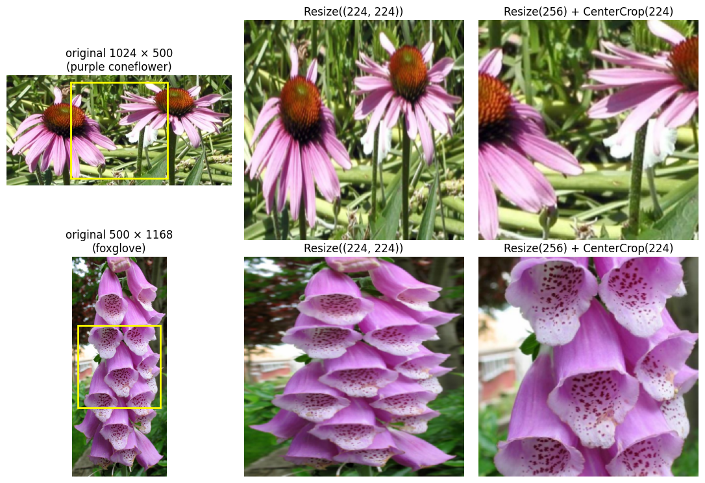
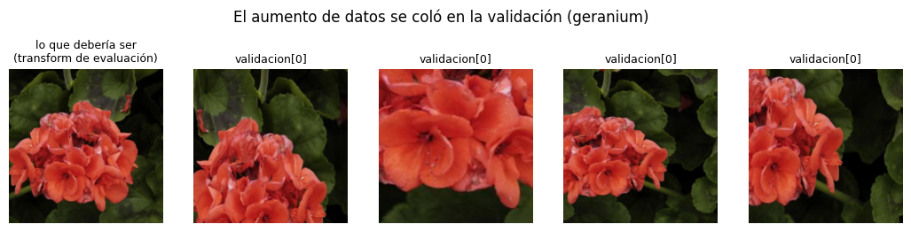
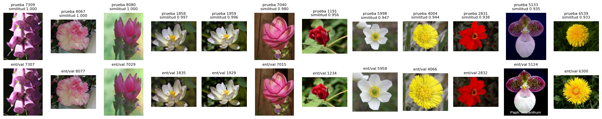
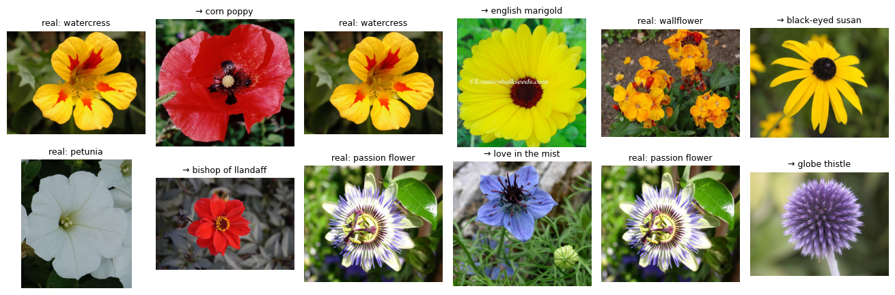

# Módulo 3: datos que un modelo puede usar

Este módulo sigue el tercer módulo del curso de PyTorch de DeepLearning.AI en Coursera. Un jardín botánico quiere una app que reconozca flores a partir de una foto. En el primer notebook, tres equipos entrenan la misma red con las mismas fotos y obtienen resultados muy distintos: la diferencia está en cómo manejan los datos. Aquí se construye el camino completo, desde los archivos en disco hasta los lotes que recibe el modelo, y se revisan los errores que más cuestan: transformaciones mal puestas, datos que se cuelan entre conjuntos y archivos rotos.

El dataset es [Oxford Flowers 102](https://www.robots.ox.ac.uk/~vgg/data/flowers/102/): 8.189 fotos de 102 especies. Lo describe el notebook [Flowers 102 por dentro](05-profundizacion/03_flowers_102_el_articulo_original.ipynb) a partir del artículo original.

<table>
  <tr>
    <td width="50%" valign="top">
      
       <b>Transforms para fotos</b>: cada foto llega con un tamaño distinto. <code>Resize</code> y <code>CenterCrop</code> la dejan cuadrada sin deformarla.
    </td>
    <td width="50%" valign="top">
      
       <b>Carga</b>: si el aumento de datos se aplica a la validación por error, las fotos de validación ya no son las originales. La primera foto es la que debería verse.
    </td>
  </tr>
  <tr>
    <td width="50%" valign="top">
      
       <b>Fuga de datos</b>: fotos de prueba y sus parecidas en entrenamiento o validación. Si se mezclan, la exactitud sale mejor de lo que será con datos nuevos.
    </td>
    <td width="50%" valign="top">
      
       <b>Flowers 102 por dentro</b>: flores que el clasificador confunde. Cada par muestra la clase real y la que predijo.
    </td>
  </tr>
</table>

## Contenido

| Parte | Notebook | Qué cubre |
|---|---|---|
| **00 · Acceso** | [Un `Dataset` propio para Oxford Flowers](00-acceso/01_un_dataset_propio.ipynb) | Encontrar los archivos y asociar cada foto con su etiqueta, el `Dataset` con sus tres métodos, por qué no cargar todo de una vez y cómo probarlo antes de entrenar |
| **01 · Calidad** | [Transforms para fotos de todos los tamaños](01-calidad/01_transforms_para_fotos.ipynb) | Por qué falla el primer lote, `Resize` y `CenterCrop`, `ToTensor`, `Normalize` y de quién es la media, el puente entre PIL y los tensores, `transforms.v2` y un pipeline completo |
| **02 · Carga** | [Dividir los datos y armar los `DataLoader`](02-carga/01_division_y_dataloader.ipynb) | `random_split` 70/15/15, subconjuntos que son vistas, la trampa del transform compartido, qué clases caen en cada conjunto, la división oficial de Oxford, mezclar o no, lotes y épocas |
| **03 · Robustez** | [Pipelines a prueba de fallas](03-robustez/01_pipelines_a_prueba_de_fallas.ipynb) | Aumento de datos al vuelo y cómo revisarlo antes de entrenar, archivos rotos, `verify()` contra `load()`, un `__getitem__` robusto, monitoreo de la carga y varios procesos |
| **05 · Profundización** | [Fuga de datos](05-profundizacion/01_fuga_de_datos.ipynb) | Selección de características y normalización con todos los datos, aumento antes de dividir, copias entre conjuntos, validación cruzada a mano y una lista de verificación |
| | [Datos antes que el modelo](05-profundizacion/02_datos_antes_que_el_modelo.ipynb) | IA centrada en los datos: con el modelo fijo, mejorar copias, basura, etiquetas y clases escasas, y qué no muestra el experimento |
| | [Flowers 102 por dentro](05-profundizacion/03_flowers_102_el_articulo_original.ipynb) | El artículo de Nilsback y Zisserman (2008): segmentación, color y forma como características, vecino más cercano, kernels y el error por clase |

Las partes 00 a 03 forman una secuencia: cada una usa lo que armó la anterior. Las de la parte 05 son independientes entre sí y suponen haber leído las partes 00 a 03.

## Los datos

Los notebooks descargan Oxford Flowers 102 la primera vez que se ejecutan, en la carpeta `modulo-3/data`, que comparten todos. El notebook de [datos antes que el modelo](05-profundizacion/02_datos_antes_que_el_modelo.ipynb) también descarga MNIST y Fashion-MNIST en esa misma carpeta. La carpeta no se sube al repositorio.

## Conocimientos previos

Haber leído el [módulo 2](../modulo-2), sobre todo `Dataset`, `DataLoader` y transforms. Para la parte 05 ayuda haber visto una vez la validación cruzada, aunque el notebook la explica.

## Cómo ejecutarlo

Los notebooks se ejecutan igual que en el resto del repositorio. Ver [Cómo ejecutarlos](../README.md#cómo-ejecutarlos) en el README principal.
