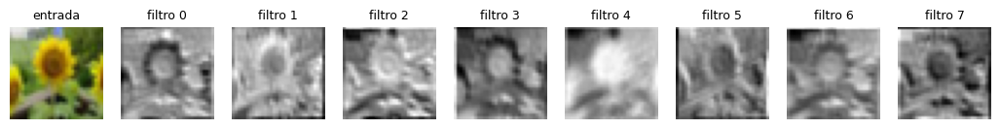
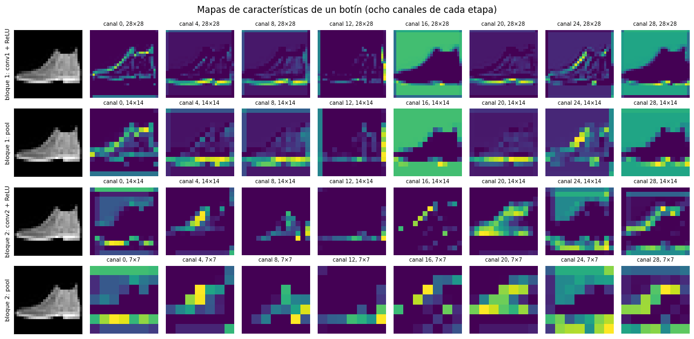
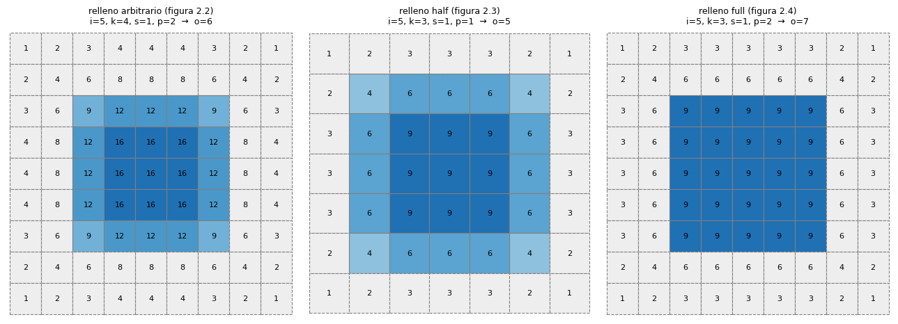
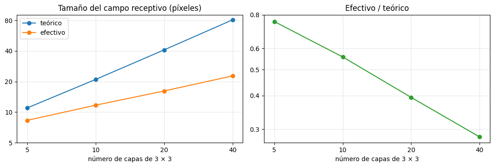

# Módulo 4: redes convolucionales y cómo mantenerlas

Este módulo sigue el cuarto módulo del curso de PyTorch de DeepLearning.AI en Coursera. Usa el pipeline de datos del módulo 3 para construir la pieza que las redes de imágenes necesitan: la convolución. Un filtro de 3 × 3 recorre la foto y deja un mapa de características. Después se arma una CNN con esas piezas, se estudia cómo se calculan sus tamaños y campos receptivos, y se ve cómo escribirla de forma que se pueda cambiar y depurar.

La idea del módulo es que cada capa tiene una razón de ser. Las capas densas no escalan a fotos; la convolución aprovecha que los píxeles vecinos se parecen entre sí y usa los mismos pesos en toda la imagen.

<table>
  <tr>
    <td width="50%" valign="top">
      
       <b>Filtros y mapas de características</b>: una foto de girasol y lo que deja cada uno de los ocho filtros de una capa <code>Conv2d</code>.
    </td>
    <td width="50%" valign="top">
      
       <b>La arquitectura de una CNN</b>: un botín en cada etapa de la red. Cada etapa reduce el tamaño del mapa a la mitad con el <i>pooling</i>.
    </td>
  </tr>
  <tr>
    <td width="50%" valign="top">
      
       <b>Aritmética de la convolución</b>: la misma convolución con tres tipos de relleno. La salida crece de 5 a 7 según cuánto se rellene.
    </td>
    <td width="50%" valign="top">
      
       <b>Campos receptivos</b>: cuánto de la imagen ve una neurona. El campo efectivo es menor que el teórico, y la diferencia crece con la profundidad.
    </td>
  </tr>
</table>

## Contenido

| Parte | Notebook | Qué cubre |
|---|---|---|
| **00 · Convoluciones** | [Filtros y mapas de características](00-convoluciones/01_filtros_y_mapas_de_caracteristicas.ipynb) | Por qué las capas densas no escalan a fotos, la convolución a mano y con `F.conv2d`, mapas de características, `nn.Conv2d` por dentro, relleno y paso, parámetros compartidos, equivariancia y una red que aprende su filtro |
| **01 · Arquitectura** | [La arquitectura de una CNN](01-arquitectura/01_la_arquitectura_de_una_cnn.ipynb) | La receta de una CNN, ReLU y <i>max pooling</i> a mano, de dónde sale el `64 * 7 * 7`, entrenamiento, qué aprendió la red, la comparación con la red densa del módulo 2 y qué ve cada neurona |
| **03 · Grafos dinámicos** | [Grafos dinámicos](03-grafos-dinamicos/01_grafos_dinamicos.ipynb) | El grafo se arma en cada pasada: `if` y bucles dentro del `forward`, una red con dos cabezas, entradas de largo variable, `print` y hooks, salida temprana y lo que cuesta un grafo dinámico |
| **04 · Modular e inspección** | [Bloques, inspección y depuración](04-modular-e-inspeccion/01_bloques_inspeccion_y_depuracion.ipynb) | Una CNN escrita a mano, capas declaradas que nunca se usan, `nn.Sequential`, un bloque propio, cambiar una línea sin romper el resto, `named_parameters`, `children` contra `modules`, errores de formas e inicialización |
| **05 · Profundización** | [Aritmética de la convolución](05-profundizacion/01_aritmetica_de_la_convolucion.ipynb) | La guía de Dumoulin y Visin: relleno, paso, *pooling*, la convolución como una matriz, la transpuesta, la dilatada y los tamaños de las CNN del módulo |
| | [Campos receptivos](05-profundizacion/02_campos_receptivos.ipynb) | El tamaño teórico y el efectivo, tres capas de 3 × 3 contra una de 7 × 7, convoluciones dilatadas, y si el campo cambia al entrenar |

Los notebooks de las partes 00, 01, 03 y 04 se leen en ese orden, porque cada uno usa lo del anterior. Los de la parte 05 suponen haber leído la parte 00 y la 01.

## Los datos

Los notebooks descargan FashionMNIST, MNIST y CIFAR-100 la primera vez que se ejecutan, en la carpeta `modulo-4/data`, que comparten todos. La carpeta no se sube al repositorio.

## Conocimientos previos

Haber leído el [módulo 3](../modulo-3), sobre todo los `DataLoader` y los transforms, y la parte 04 del [módulo 1](../modulo-1/04-matematica-de-pytorch), sobre autograd. Para la parte 05 ayuda saber qué es un gradiente, aunque el notebook de campos receptivos lo calcula con PyTorch.

## Cómo ejecutarlo

Los notebooks se ejecutan igual que en el resto del repositorio. Ver [Cómo ejecutarlos](../README.md#cómo-ejecutarlos) en el README principal.
